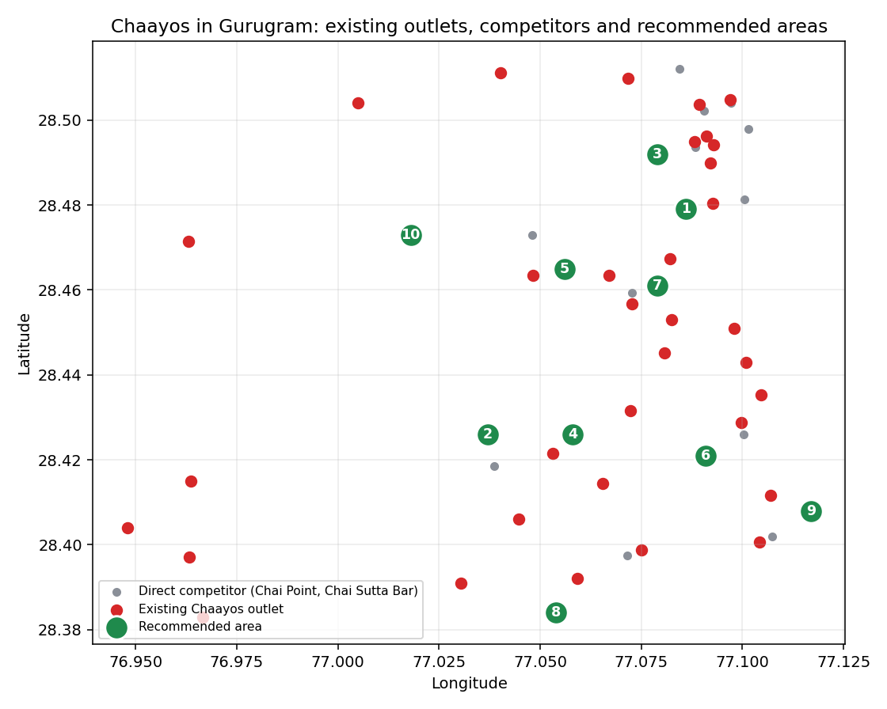

# Where should Chaayos open its next cafe in Gurugram?
### A SQL location-strategy project: MySQL, Google Maps data, 60 candidate sites scored



## 30-second summary
| | |
|---|---|
| **Problem** | A cafe chain wants to open a new outlet but does not know where. Pick the wrong spot and you either miss footfall or steal sales from your own nearby outlet. |
| **What I did** | Collected and cleaned Google Maps data (34 Chaayos outlets, 223 demand points, 15 direct competitors, 56 premium cafes) and scored every mall and office park in Gurugram with SQL. |
| **SQL used** | Joins, CTEs, window functions, correlated subqueries, `CREATE TABLE AS`, session variables, spatial distance (`ST_Distance_Sphere`), validation queries |
| **Answer** | Top 5 areas: Sahara Mall, Orchid Business Park, Sewa Tower, Baani Square, DLF World Techpark. Full top 10 below. |
| **How far to trust it** | It is a shortlist for site visits, not a final answer. The score partly agrees with existing outlets (details in the validation section). |

## 1. The business problem
A good cafe location has three things: **footfall nearby** (offices, malls, metro, hospitals, colleges), **no Chaayos too close** (cannibalisation) and **limited direct competition** (other chai chains). The project turns those three ideas into one score that SQL can compute for any location.

## 2. How the project works
```
Google Maps scrape  ->  clean and de-duplicate  ->  load into MySQL  ->  distance tables
        ->  score every candidate  ->  shortlist  ->  validate against existing outlets
```
Every mall and office park is a **candidate location**. Every other place (metro, hospital, college, company offices) only adds to **demand**, because a cafe cannot open inside a BPO.

## 3. The data
| File | Rows | What it holds |
|---|---|---|
| `outlets.csv` | 34 | Existing Chaayos outlets in Gurugram (name, sector, type, rating, reviews, lat/long) |
| `poi.csv` | 223 | Demand points: 53 malls, 77 office parks, 44 hospitals, 37 colleges, 12 metro stations |
| `direct_competitors.csv` | 15 | Chai Point and Chai Sutta Bar outlets |
| `indirect_cafes.csv` | 56 | Starbucks, Third Wave Coffee, Blue Tokai (shows that people pay for cafes in an area) |
| `cleaning_log.csv` | 200+ | Every row I removed during cleaning, with the reason |
| `shortlist.csv` | 10 | Final shortlisted areas with all score components |

**Cleaning decisions (all logged):** removed listings outside Gurugram, brand stores inside malls, clinics listed as hospitals, ATMs, parking and gate listings, duplicate listings of the same building (same-brand rows within 50 to 150 m) and rows with too few reviews to be reliable. Chai Point stalls that were not the brand were dropped.

## 4. The scoring method
For each candidate, within a **1 km radius**:

```
opportunity = demand_index * (1 + 0.3 * ln(1 + premium_cafes))
              / (1 + 1.0 * chaayos_pressure)
              / (1 + 0.5 * competitor_pressure)
```
* **demand** = sum over nearby places of `type_weight * ln(1 + google_reviews) * (1 - distance / radius)`
  * Google review count is the footfall proxy. `ln` stops one huge mall from drowning everything else. Closer places count more.
  * Type weights: office park 1.0, mall 1.0, metro 0.8, hospital 0.5, college 0.5. Metro stations have no reviews, so they get a fixed review-equivalent of 5,000.
* **chaayos_pressure / competitor_pressure** = sum of `(1 - distance / radius)` over nearby Chaayos outlets / direct competitors.
* A candidate within **0.5 km** of an existing Chaayos is dropped completely.
* A candidate makes the shortlist only if **no higher-scoring candidate lies within 1.5 km**, so the picks cover different parts of the city.

All of these numbers are variables at the top of Section 3 of the SQL file, so you can change them and re-run.

## 5. Results: top 10 shortlisted areas
| # | Location | Type | Score | Nearest Chaayos | Direct rivals within 1 km | Premium cafes within 1 km |
|---|---|---|---|---|---|---|
| 1 | Sahara Mall | mall | 47.8 | 0.6 km | 0 | 3 |
| 2 | Orchid Business Park | office park | 42.2 | 1.7 km | 1 | 1 |
| 3 | Sewa Tower | office park | 35.7 | 1.0 km | 2 | 1 |
| 4 | Baani Square | mall | 29.0 | 0.7 km | 0 | 1 |
| 5 | DLF World Techpark (DLF IT SEZ) | office park | 24.2 | 0.8 km | 0 | 2 |
| 6 | Hong Kong Bazaar | mall | 16.2 | 1.2 km | 0 | 1 |
| 7 | Sushant Shopping Arcade | mall | 14.6 | 0.8 km | 1 | 5 |
| 8 | Elan Town Centre | mall | 14.1 | 1.0 km | 0 | 1 |
| 9 | International Tech Park Gurgaon | office park | 13.3 | 1.0 km | 0 | 0 |
| 10 | Dreamz Mall | mall | 10.6 | 3.2 km | 0 | 0 |

## 6. The SQL
One file, `chaayos_location_analysis.sql`, runs on **MySQL 8** from a blank server (no setup needed):

* **Part 1:** creates the database and 4 tables, loads all the data and prints row counts.
* **Part 2:** the full analysis in 6 sections (below). Run the whole file at once, or select one part and press `Ctrl+Shift+Enter` in MySQL Workbench.

| Section | Contents | SQL skills |
|---|---|---|
| 1. Data audit | Coordinate bounds, nulls, duplicates | `UNION ALL`, `COUNT(DISTINCT ...)` |
| 2. Exploratory analysis | Outlets by type, POIs by type, competition landscape, biggest malls and offices | `GROUP BY`, aggregates |
| 3. Settings and distance tables | Parameters as session variables, candidate table, candidate-to-everything distance tables | `CROSS JOIN`, `ST_Distance_Sphere`, `CREATE TABLE AS`, `NOT REGEXP` |
| 4. Scoring | Demand, cannibalisation, competition, final opportunity score | CTEs, conditional aggregation, window functions (`MIN() OVER`, `MAX() OVER`) |
| 5. Shortlist | Spatially spread top 10, plus "white space" areas with no Chaayos and no direct rival | Correlated subquery (`NOT EXISTS`) |
| 6. Validation | Same score at the 34 existing outlets, compared with all candidates | Scalar subqueries, `RANK() OVER` |

## 7. Does the score make sense? (validation and honest limitations)
* **Partly.** The demand score correlates positively with how busy existing outlets are (Spearman 0.51 between score and outlet review count).
* **But not fully.** Existing outlets sit at only about the **39th percentile on average** (median 27th) of the demand score. The score likes dense office districts more than Chaayos' own history does, because many Chaayos outlets sit in malls and markets.
* **Not fully stable.** Sahara Mall is first at 0.75 km and 1 km radius, but no candidate stays in the top 5 at every radius. Treat the result as a **shortlist for site visits**.
* Google review count is a proxy for footfall, not real footfall. Newer places get fewer reviews than they deserve.
* Distances are straight line, not road distance. Gurugram traffic makes 1 km feel much longer.
* No rent, population or Chaayos sales data was available, so the model cannot predict revenue.
* Weights are judgement calls. Only the radius was stress-tested.

## 8. What I would do next
Calibrate the weights against real outlet sales, add rent and residential population, test road-distance catchments, and model how much a new outlet would take from each nearby outlet (a Huff-style share model).


---
*Built by Dishu Goyal. Tools: MySQL 8, Python, Google Maps data.*
